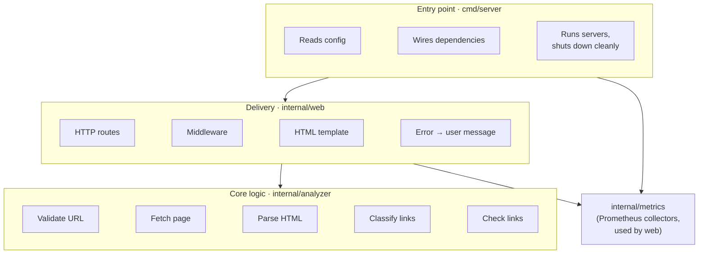
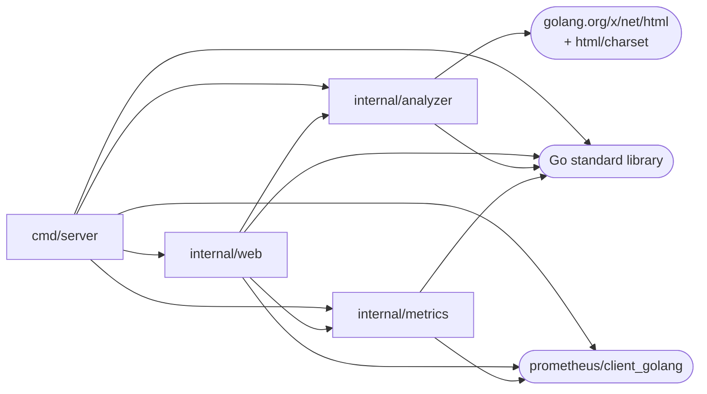
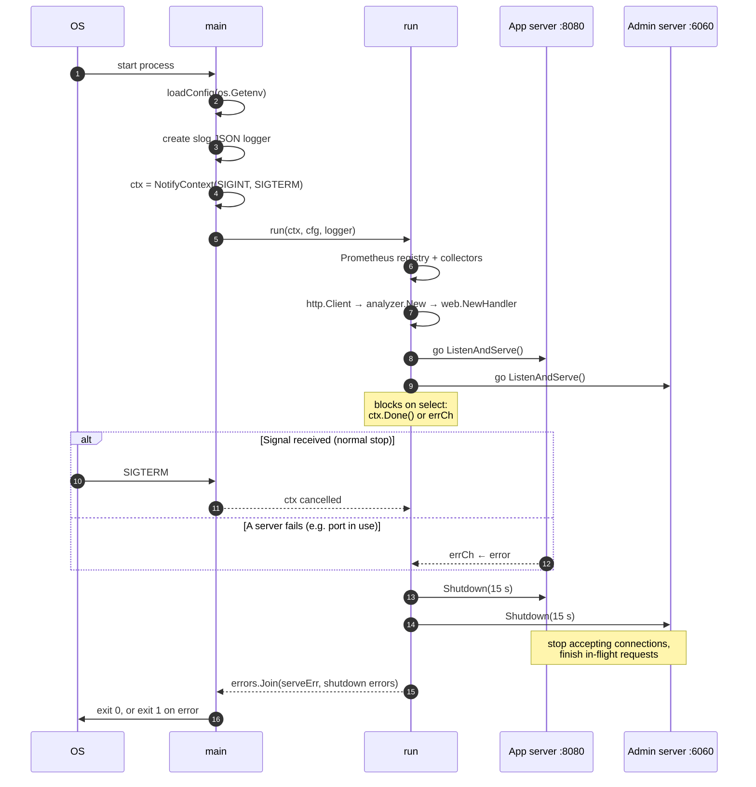
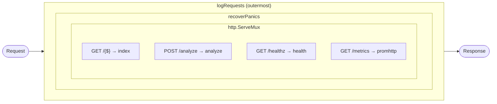
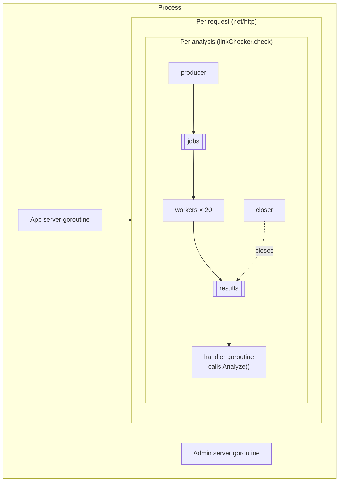
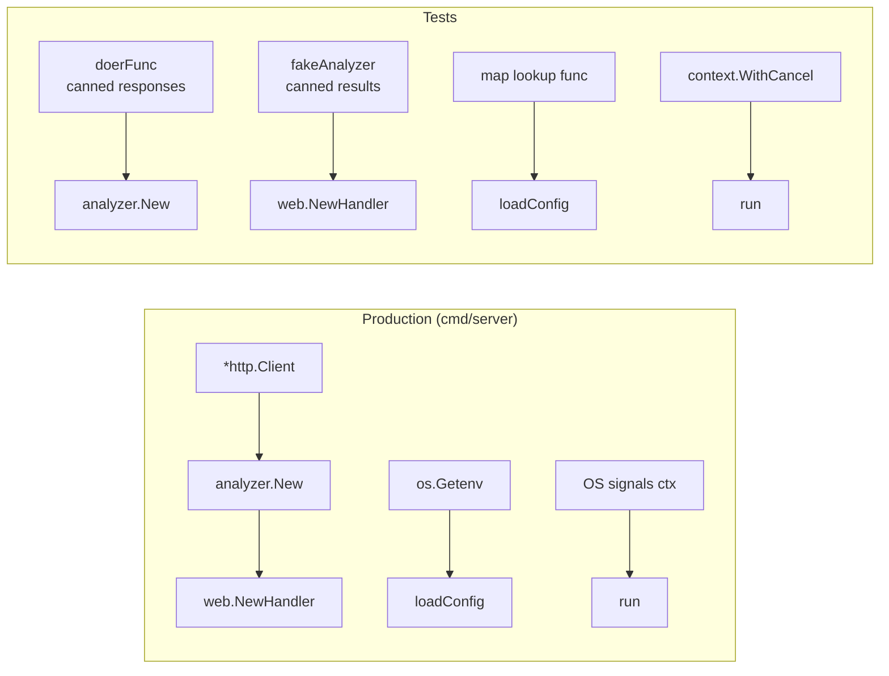
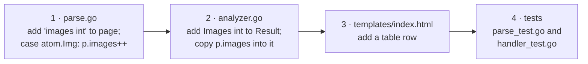

# Code architecture

This document explains how the code is organized and why. To follow a single request through the code step by step, see [How a URL gets analyzed](how-analysis-works.md).

## Contents

1. [The big picture](#1-the-big-picture)
2. [Packages](#2-packages)
3. [Dependency rules](#3-dependency-rules)
4. [Key types and interfaces](#4-key-types-and-interfaces)
5. [Startup and shutdown](#5-startup-and-shutdown)
6. [Middleware chain](#6-middleware-chain)
7. [Concurrency model](#7-concurrency-model)
8. [Testing seams](#8-testing-seams)
9. [Design principles](#9-design-principles)
10. [How to extend the code](#10-how-to-extend-the-code)

---

## 1. The big picture

The application has three layers. Each layer only talks to the layer directly below it.



| Layer | Answers the question | Knows about HTTP requests from users? | Knows about HTML templates? |
|---|---|---|---|
| `cmd/server` | How is the app started and stopped? | only to start servers | no |
| `internal/web` | How does a user interact with the analyzer? | yes | yes |
| `internal/analyzer` | What facts does a web page contain? | **no** | **no** |

The analyzer doesn't know it's being used from a web page. The same package could be used from a CLI tool, a JSON API or a background job without changes.

---

## 2. Packages

```
web-analyzer/
├── cmd/server/                 package main
│   ├── main.go                 main(), run(), pprofMux()
│   └── config.go               config struct, loadConfig()
│
├── internal/analyzer/          package analyzer
│   ├── analyzer.go             Analyzer, Config, Result, HTTPDoer, Analyze(), fetch()
│   ├── url.go                  NormalizeURL()
│   ├── parse.go                page, parsePage(), walk(), detectVersion()
│   ├── links.go                linkSummary, classifyLinks(), sameSite()
│   ├── linkcheck.go            linkChecker, BrokenLink, check(), checkOne()
│   └── errors.go               ErrInvalidURL, FetchError, transportError()
│
├── internal/web/               package web
│   ├── handler.go              Handler, Analyzer interface, routes, analyze(), describeError(), render()
│   ├── middleware.go           logRequests(), recoverPanics(), statusRecorder
│   └── templates/index.html    the only page (form + result + error)
│
└── internal/metrics/           package metrics
    └── metrics.go              Metrics struct, New()
```

### What each file is responsible for

| File | Responsibility | Exported? |
|---|---|---|
| `analyzer/analyzer.go` | Runs the pipeline and owns configuration and the result type | `Analyzer`, `New`, `Config`, `Result`, `HeadingCount`, `HTTPDoer` |
| `analyzer/url.go` | Turns user input into a valid absolute URL | `NormalizeURL` |
| `analyzer/parse.go` | Extracts facts from the HTML tree in one pass | nothing (internal detail) |
| `analyzer/links.go` | Decides internal vs external, deduplicates | nothing |
| `analyzer/linkcheck.go` | Checks links concurrently | `BrokenLink` (part of `Result`) |
| `analyzer/errors.go` | Defines error types callers can inspect | `ErrInvalidURL`, `FetchError` |
| `web/handler.go` | Maps HTTP requests to analyzer calls and results to HTML | `Handler`, `NewHandler`, `Analyzer` |
| `web/middleware.go` | Cross-cutting concerns for every request | nothing |
| `metrics/metrics.go` | Defines all Prometheus metrics in one place | `Metrics`, `New` |
| `server/main.go` | Builds real dependencies and runs both servers | – |
| `server/config.go` | Reads environment variables | – |

The analyzer exposes only what callers need. Parsing, classification and checking are unexported, so they can change without affecting other packages.

### Why `internal/`

Go doesn't allow code outside this module to import packages under `internal/`. That makes clear these packages are building blocks of this app, not a public library.

---

## 3. Dependency rules



Three rules keep the structure clean:

1. **Arrows only point downward.** `analyzer` imports nothing from this module, and `web` never imports `cmd/server`. There are no import cycles.
2. **The analyzer has a single third-party dependency** (`x/net/html`, which is maintained by the Go team). It doesn't depend on Prometheus, templates or logging. Metrics are recorded by the web layer from the returned `Result`.
3. **Only `cmd/server` creates concrete dependencies** (`*http.Client`, the Prometheus registry, the logger). Every other package receives them through constructors.

---

## 4. Key types and interfaces

```mermaid
classDiagram
    direction LR

    class HTTPDoer {
        <<interface>>
        Do(*http.Request) (*http.Response, error)
    }

    class Analyzer {
        -client HTTPDoer
        -cfg Config
        -checker *linkChecker
        +Analyze(ctx, rawURL) (*Result, error)
        -fetch(ctx, *url.URL) (*url.URL, *page, error)
    }

    class linkChecker {
        -client HTTPDoer
        -workers int
        -timeout Duration
        -check(ctx, urls) ([]BrokenLink, int)
        -checkOne(ctx, url) linkResult
    }

    class Config {
        +FetchTimeout Duration
        +LinkTimeout Duration
        +LinkCheckBudget Duration
        +Workers int
        +MaxBodyBytes int64
    }

    class Result {
        +URL, HTMLVersion, Title string
        +Headings []HeadingCount
        +InternalLinks, ExternalLinks int
        +CheckedLinks, UncheckedLinks int
        +InaccessibleLinks []BrokenLink
        +HasLoginForm bool
    }

    class FetchError {
        +StatusCode int
        +Message string
        +Err error
        +Error() string
        +Unwrap() error
    }

    class webAnalyzer["web.Analyzer"] {
        <<interface>>
        Analyze(ctx, rawURL) (*Result, error)
    }

    class Handler {
        -analyzer web.Analyzer
        -metrics *Metrics
        -logger *slog.Logger
        -tmpl *template.Template
        +Routes(metricsHandler) http.Handler
    }

    Analyzer --> HTTPDoer : uses
    Analyzer *-- linkChecker
    Analyzer *-- Config
    linkChecker --> HTTPDoer : uses
    Analyzer ..> Result : returns
    Analyzer ..> FetchError : returns
    Analyzer ..|> webAnalyzer : satisfies
    Handler --> webAnalyzer : uses
```



### The two interfaces

Both interfaces are defined **by the package that uses them**, not by the package that implements them. This is the Go convention ("accept interfaces, return structs").

| Interface | Declared in | Methods | Why it exists |
|---|---|---|---|
| `analyzer.HTTPDoer` | analyzer | `Do` | The analyzer needs to send requests, not a whole `*http.Client`. Tests pass a function instead. |
| `web.Analyzer` | web | `Analyze` | The handler needs one method, not the analyzer's internals. Tests pass a fake that returns canned results. |

`*analyzer.Analyzer` never declares that it implements `web.Analyzer`. Go interfaces are satisfied implicitly, so it does simply because it has a matching `Analyze` method.

### Errors

| Error | Kind | Checked with | Meaning |
|---|---|---|---|
| `ErrInvalidURL` | sentinel value, wrapped with `%w` | `errors.Is` | The user's input is wrong |
| `*FetchError` | struct with fields | `errors.As` | The target page couldn't be retrieved; carries the status code |
| anything else | – | default case | Unexpected bug; logged, shown as a generic 500 |

---

## 5. Startup and shutdown

`main` is kept tiny. All the work happens in `run`, which takes a `context.Context`, so a test can start the real server and stop it by cancelling the context.



Both servers are always shut down, even when only one of them failed.

### Why two servers

| Server | Default address | Serves | Exposed in Docker |
|---|---|---|---|
| App | `:8080` | UI, `/healthz`, `/metrics` | yes |
| Admin | `localhost:6060` | `/debug/pprof/*` | no |

pprof can reveal internals and is expensive to run, so it is kept on a separate port that only listens locally.

---

## 6. Middleware chain

Middleware are plain functions with the signature `func(http.Handler) http.Handler`. No framework is needed.



The order is deliberate:

| Layer | Does | Why it's at this position |
|---|---|---|
| `logRequests` | Request ID, timing, JSON log line, request metrics | Outermost, so it sees the final status of **every** response, including 500s from recovered panics |
| `recoverPanics` | Turns a panic into a 500 and logs the stack trace | Inside logging, so the 500 is still logged and counted |
| `ServeMux` | Routes by method and path (Go 1.22+ patterns) | Sets `r.Pattern`, which `logRequests` reads afterwards to use as a low-cardinality metric label |

`statusRecorder` wraps the `ResponseWriter` to capture the status code, because `http.ResponseWriter` has no way to read it back.

---

## 7. Concurrency model

| Goroutine | Started by | Lifetime | Stops when |
|---|---|---|---|
| App server listener | `run` | whole process | `Shutdown` |
| Admin server listener | `run` | whole process | `Shutdown` |
| One per incoming request | `net/http` | one request | handler returns |
| Link-check producer | `linkChecker.check` | one analysis | all URLs sent, `jobs` closed |
| Link-check workers (≤ 20) | `linkChecker.check` via `wg.Go` | one analysis | `jobs` closed and drained |
| Link-check closer | `linkChecker.check` | one analysis | `wg.Wait()` returns, `results` closed |



Rules that prevent leaks and races:

- **Every goroutine has a clear end.** The workers end when `jobs` is closed, the closer when `wg.Wait()` returns, and the collector when `results` is closed.
- **The sender closes the channel.** The producer closes `jobs`, and only the closer closes `results`, after every worker that could send on it has finished.
- **Cancellation flows through `context.Context`.** If the user closes the browser tab, `r.Context()` is cancelled. That cancels the page fetch and every link check that's still running.
- **No shared mutable state between requests.** `Analyzer` and `Handler` are read-only after construction, so they're safe for concurrent use without locks.
- **Verified with `go test -race`**, which `make test` always runs.

---

## 8. Testing seams

Every external dependency enters through an interface or a function parameter, so tests can replace it.



| What is tested | Real dependency | Replaced in tests by | Test file |
|---|---|---|---|
| Fetch, parse, classify, check | `*http.Client` | `doerFunc` | `analyzer/*_test.go` |
| Handlers, templates, errors, metrics | `*analyzer.Analyzer` | `fakeAnalyzer` | `web/handler_test.go` |
| Environment config | `os.Getenv` | `func(k) string { return m[k] }` | `server/config_test.go` |
| Startup and shutdown | OS signals | a cancellable context | `server/config_test.go` |
| Real network end to end | – | not replaced (build tag `integration`) | `analyzer/integration_test.go` |

---

## 9. Design principles

| Principle | Where you can see it |
|---|---|
| **Small packages organized by responsibility**, not by type (no `models/`, `services/`, `utils/`) | `analyzer`, `web`, `metrics` |
| **Small interfaces, defined by the consumer** | `HTTPDoer` (1 method), `web.Analyzer` (1 method) |
| **Dependencies passed in through constructors**, no global state | `analyzer.New(client, cfg)`, `web.NewHandler(a, m, logger)` |
| **Zero-value-friendly config** | `analyzer.Config{}` works; `withDefaults()` fills in the gaps |
| **Errors are values**, wrapped with context and inspected with `errors.Is`/`errors.As` | `errors.go`, `describeError` |
| **Context everywhere I/O happens** | `Analyze(ctx, …)`, `NewRequestWithContext`, per-link `WithTimeout` |
| **Standard library first** | routing, templates, logging, profiling and URL parsing are all stdlib |
| **No getters/setters or class hierarchies** | plain structs with exported fields for data (`Result`), unexported fields for behaviour (`Analyzer`) |
| **Fail safe output** | templates rendered into a buffer first; `html/template` escapes all page content |

---

## 10. How to extend the code

### Example: also count images on the page

The change touches each layer once, from the bottom up:



### Where to make common changes

| I want to… | Change |
|---|---|
| Report a new fact about the page | `page` + `walk` in `parse.go`, then `Result` in `analyzer.go`, then the template |
| Change what counts as internal | `sameSite` in `links.go` |
| Change how a link is judged broken | `checkOne` in `linkcheck.go` |
| Change timeouts or worker count | `Config.withDefaults` in `analyzer.go` |
| Change an error message or status | `transportError` in `errors.go` or `describeError` in `handler.go` |
| Add a page or endpoint | `Routes` in `handler.go` |
| Add a metric | `metrics.go`, then record it in the web layer |
| Add a JSON API | a new handler in `web` that calls the same `Analyzer` and encodes `Result`; the analyzer needs no changes |
| Add a CLI | a new `cmd/cli/main.go` that calls `analyzer.New(...).Analyze(...)` |
