# How a URL gets analyzed

This document follows one request from the moment the user presses **Analyze** until the result page is rendered. Diagrams use [Mermaid](https://mermaid.js.org/), which GitHub and most IDEs render automatically.

## Contents

1. [Components](#1-components)
2. [Request lifecycle](#2-request-lifecycle)
3. [Analysis pipeline](#3-analysis-pipeline)
4. [Step 1: URL validation](#4-step-1-url-validation)
5. [Step 2: Fetching the page](#5-step-2-fetching-the-page)
6. [Step 3: Parsing the HTML](#6-step-3-parsing-the-html)
7. [Step 4: Classifying links](#7-step-4-classifying-links)
8. [Step 5: Checking links concurrently](#8-step-5-checking-links-concurrently)
9. [Step 6: Building the result](#9-step-6-building-the-result)
10. [Error handling](#10-error-handling)
11. [Timeouts and limits](#11-timeouts-and-limits)

---

## 1. Components

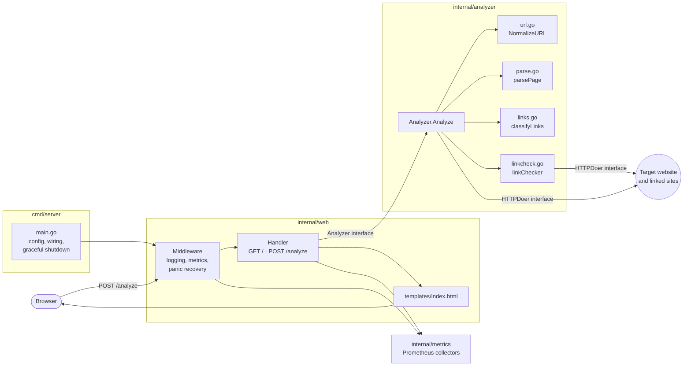

For a fuller picture of the code structure, see [Code architecture](architecture.md).

Dependencies only point inward: `cmd/server` → `web` → `analyzer`. The analyzer never imports anything from the web layer. Two small interfaces separate the layers:

| Interface | Defined in | Real implementation | Test implementation |
|---|---|---|---|
| `Analyzer` | `internal/web/handler.go` | `*analyzer.Analyzer` | `fakeAnalyzer` (returns canned results) |
| `HTTPDoer` | `internal/analyzer/analyzer.go` | `*http.Client` | `doerFunc` (returns canned responses, no network) |

---

## 2. Request lifecycle

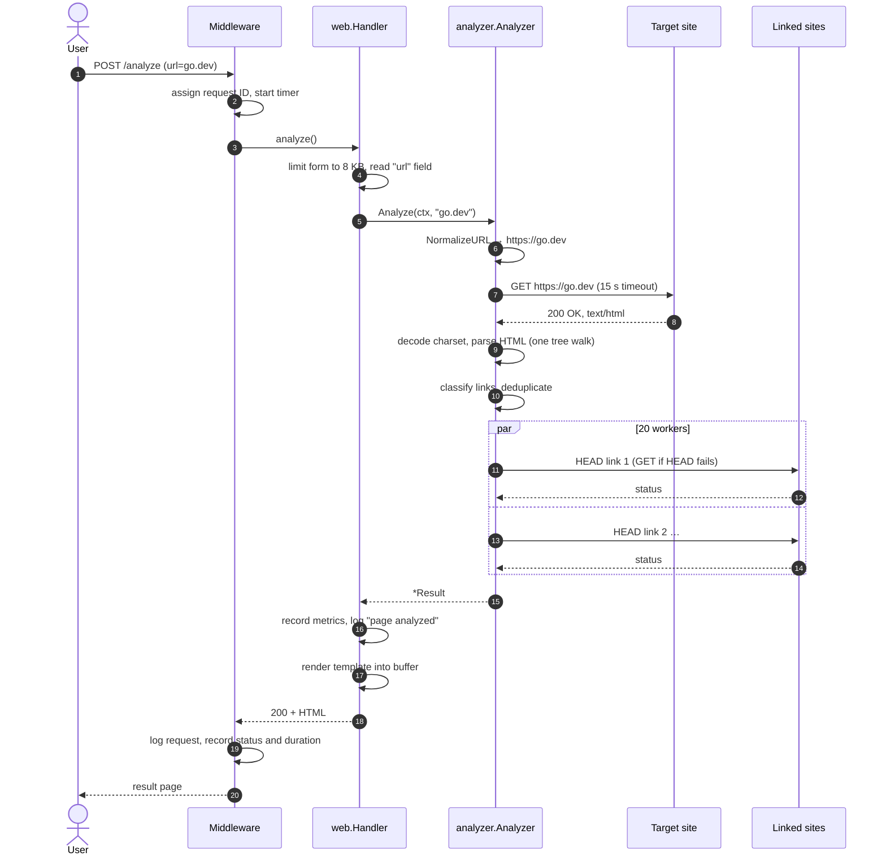

---

## 3. Analysis pipeline

`Analyzer.Analyze` (in `internal/analyzer/analyzer.go`) runs six steps in order. Any of the first three can stop the pipeline with an error.

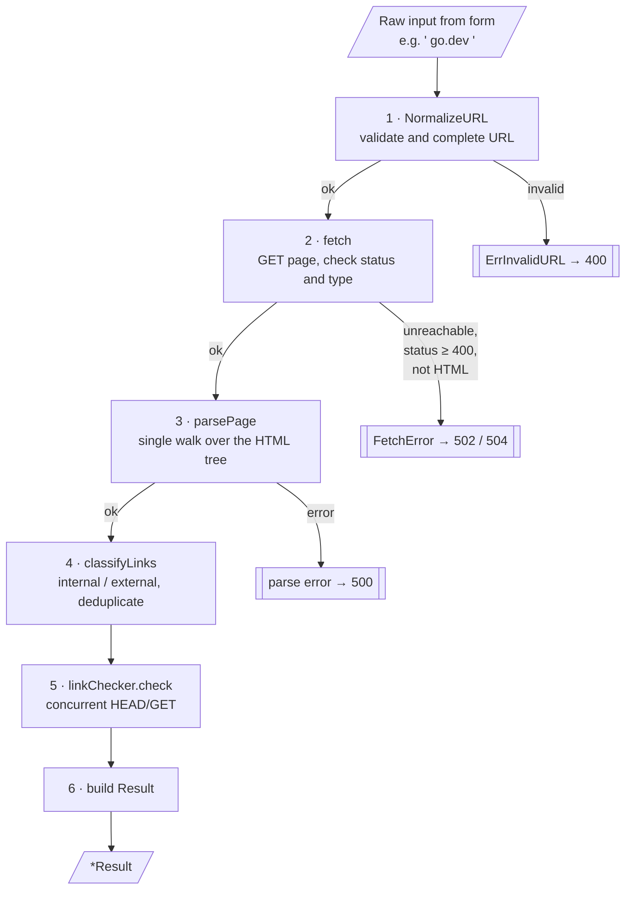

---

## 4. Step 1: URL validation

**Code:** `NormalizeURL` in `internal/analyzer/url.go`

Validation uses the standard library's `net/url` parser instead of a regular expression.

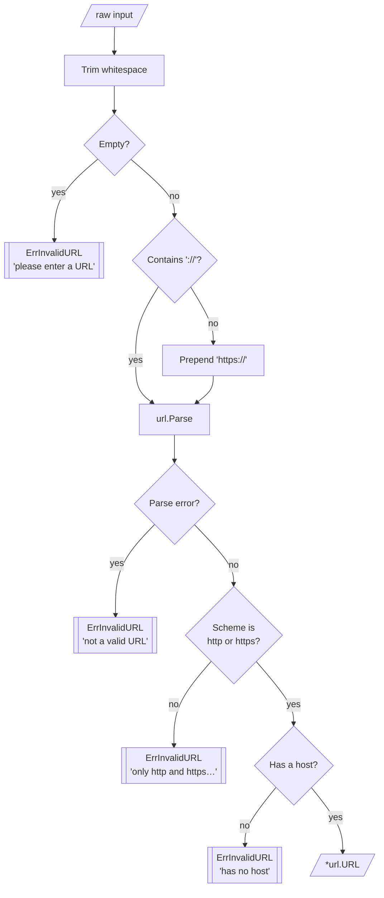

| Input | Result |
|---|---|
| `go.dev` | `https://go.dev` |
| `  http://example.com/path?q=1 ` | `http://example.com/path?q=1` |
| `ftp://example.com` | error: only http and https are supported |
| `https://` | error: no host |
| `http://exa mple.com` | error: not a valid URL |

---

## 5. Step 2: Fetching the page

**Code:** `Analyzer.fetch` in `internal/analyzer/analyzer.go`

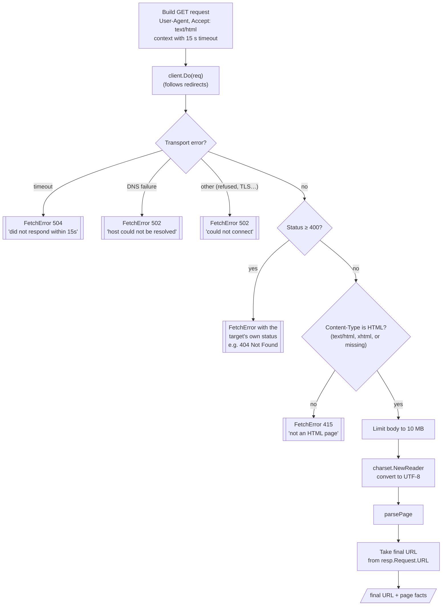

The **final URL after redirects** matters. If `http://go.dev` redirects to `https://go.dev/`, relative links like `/doc` must be resolved against the URL the content actually came from.

---

## 6. Step 3: Parsing the HTML

**Code:** `parsePage` and `page.walk` in `internal/analyzer/parse.go`

`golang.org/x/net/html` turns the page into a tree. A single recursive walk visits every node once and collects everything at the same time.

### Example

```html
<!DOCTYPE html>
<html>
  <head><title>Sample</title></head>
  <body>
    <h1>Welcome</h1>
    <a href="/about">About</a>
    <form>
      <input name="user">
      <input type="password">
    </form>
  </body>
</html>
```

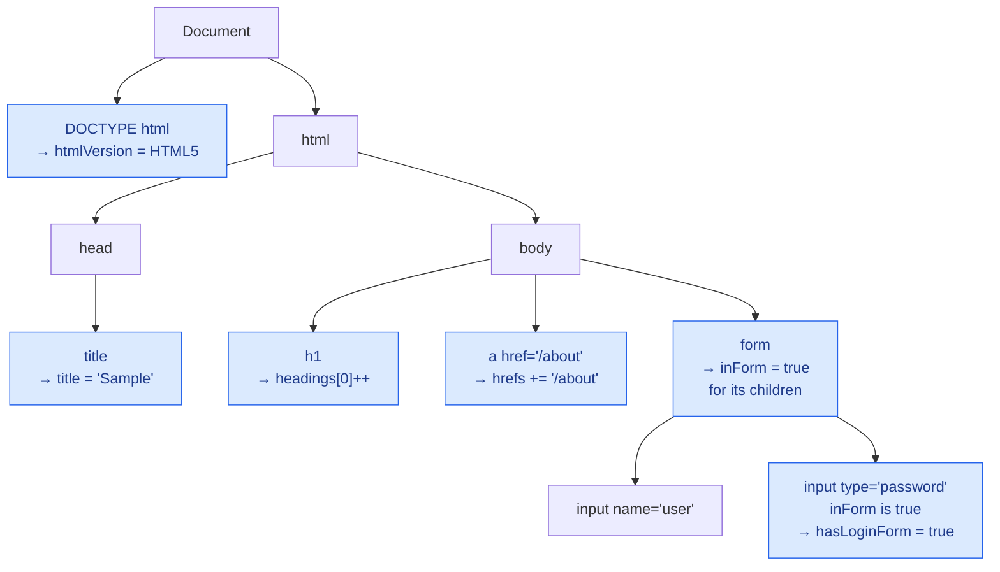

### What each node type contributes

| Node | Rule | Field set |
|---|---|---|
| `<!DOCTYPE …>` | Public identifier matched against a known list (see below) | `htmlVersion` |
| `<title>` | First one only, skipped inside `<svg>`, whitespace collapsed | `title` |
| `<h1>` … `<h6>` | Counter for that level is incremented | `headings[0..5]` |
| `<a href>` | Raw `href` value appended | `hrefs` |
| `<base href>` | First one only | `baseHref` |
| `<form>` | Sets `inForm = true` while walking its descendants | – |
| `<input type="password">` | Only counts when `inForm` is true | `hasLoginForm` |

### HTML version detection

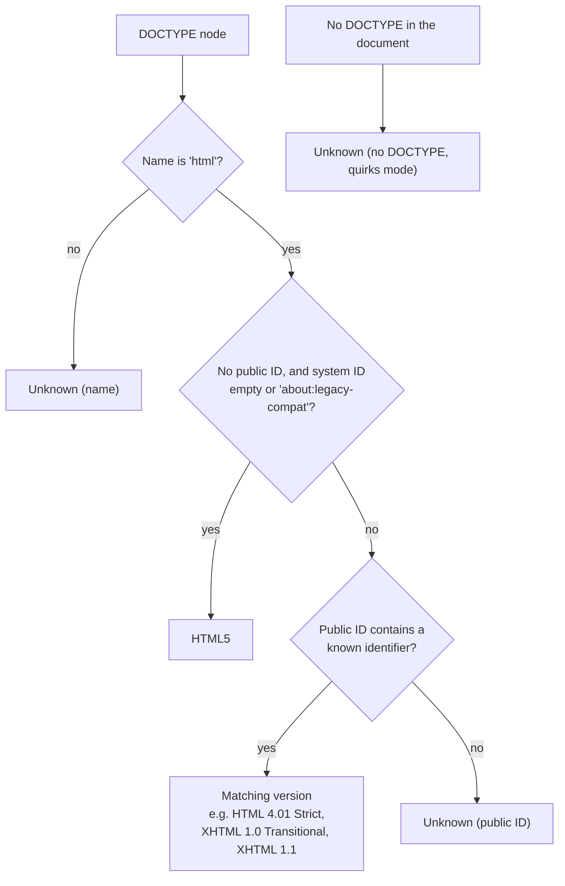

---

## 7. Step 4: Classifying links

**Code:** `classifyLinks` and `sameSite` in `internal/analyzer/links.go`

Every `href` is resolved to an absolute URL and then labelled internal or external.

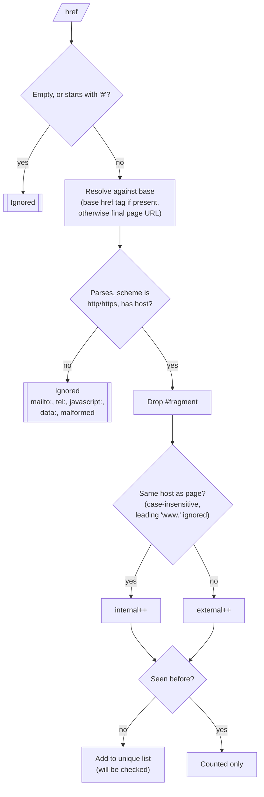

### Examples (page is `https://www.example.com/blog/post`)

| href | Resolved | Class |
|---|---|---|
| `/about` | `https://www.example.com/about` | internal |
| `contact` | `https://www.example.com/blog/contact` | internal |
| `https://example.com/a` | `https://example.com/a` | internal (`www.` ignored) |
| `//www.example.com/y` | `https://www.example.com/y` | internal |
| `https://blog.example.com/` | same | **external** (subdomain) |
| `https://golang.org` | same | external |
| `#top`, `mailto:x@y.z`, `javascript:void(0)` | – | ignored |

Counts include **every occurrence**: three links to `/about` count as three internal links. The list of URLs to check is **deduplicated**, so `/about` is only requested once.

---

## 8. Step 5: Checking links concurrently

**Code:** `linkChecker.check` and `checkOne` in `internal/analyzer/linkcheck.go`

A page can have hundreds of links. Checking them one after another could take minutes, so they're checked by a fixed-size pool of goroutines.

### Worker pool

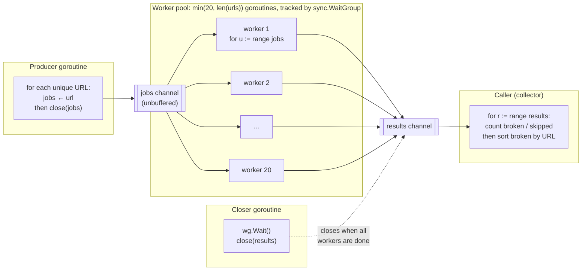

How the channels shut down:

1. The **producer** sends every URL, then closes `jobs`.
2. Each **worker** leaves its `range jobs` loop once `jobs` is closed and empty, then signals the `WaitGroup`.
3. The **closer** goroutine waits for all workers, then closes `results`.
4. The **collector** leaves its `range results` loop and returns.

Nothing is left blocked and no goroutines leak. Because only the closer closes `results`, no worker can ever send on a closed channel.

### Checking a single link

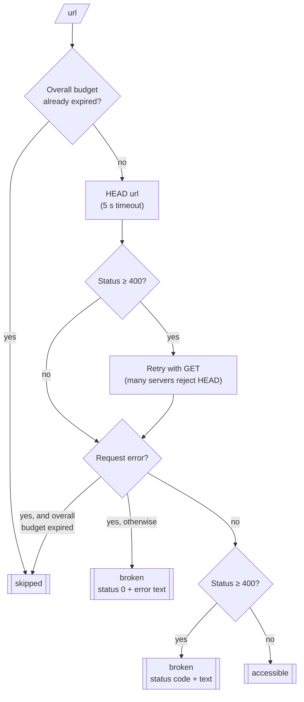

### Two kinds of timeout

There are two separate timeouts, and the checker has to tell them apart:

```mermaid
gantt
    title Link check timing (example)
    dateFormat  s
    axisFormat  %Ss

    section Overall budget
    LinkCheckBudget (30 s)        :active, budget, 0, 30s

    section Worker 1
    link A ok                     :done, a, 0, 1s
    link B slow → per-link timeout:crit, b, 1, 5s
    link C ok                     :done, c, 6, 1s

    section Worker 2
    link D ok                     :done, d, 0, 2s
    link E still running at 30 s  :e, 28, 4s
```

| Situation | Who cancelled the context | Reported as |
|---|---|---|
| Link B took more than 5 s | the per-link timeout | **inaccessible** (the site really is too slow) |
| Link E was cut off at 30 s | the overall budget | **not checked** (no fault of the site) |

After a failed request, `checkOne` looks at the budget context (`ctx.Err()`). If the budget has expired, the link is marked as skipped; otherwise the failure belongs to the link.

---

## 9. Step 6: Building the result

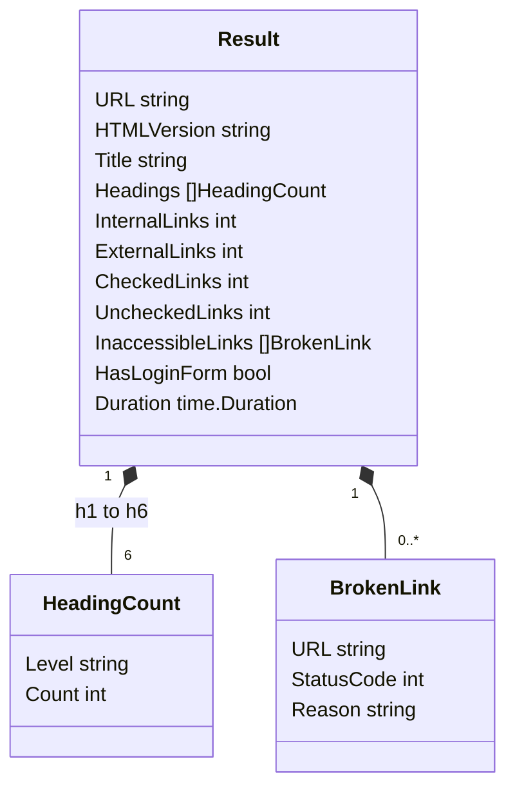

- `CheckedLinks` = unique links − skipped links
- `Headings` always has all six levels in order, so the template can show zeros.
- `InaccessibleLinks` is sorted by URL, because workers finish in random order.

The handler renders `Result` with `html/template`, which escapes all page content (a title like `<script>` is shown as text, never run).

---

## 10. Error handling

Errors are created in the analyzer and turned into user messages in exactly one place: `Handler.describeError` in `internal/web/handler.go`.

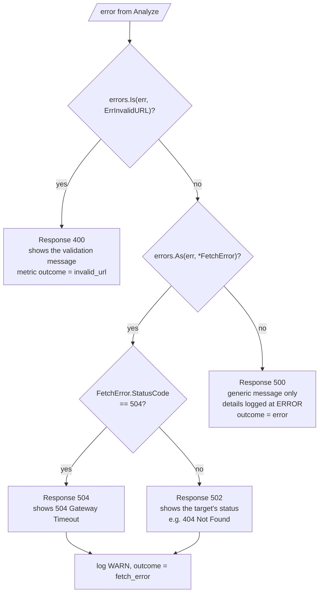

**Why the page shows 404 but the response code is 502:** the 404 came from the *target* site, and the user needs to see it. This app itself didn't fail with "not found", though. It acted as a gateway to a server that returned an error, and 502 Bad Gateway says that.

A panic anywhere in a handler is caught by the `recoverPanics` middleware, logged with its stack trace, and returned as a 500. Because that middleware sits inside `logRequests`, the 500 still appears in the request log and metrics.

---

## 11. Timeouts and limits

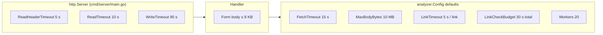

Worst case for one analysis is about 15 s (fetch) + 30 s (links) = **45 s**. That's why the server's `WriteTimeout` is 90 s, which leaves room to render and send the page.

| Limit | Value | Protects against |
|---|---|---|
| Form body | 8 KB | huge POST bodies |
| Fetch timeout | 15 s | target that never answers |
| Page size | 10 MB | huge pages using too much memory |
| Per-link timeout | 5 s | one slow link holding up a worker |
| Link budget | 30 s | pages with thousands of links |
| Workers | 20 | flooding target servers or exhausting sockets |
